Fixed-price websites and email marketing for small businesses. Based in Melbourne, working with clinics, studios, wellness brands and local services across Australia and New Zealand.

Byteberry is run by Deepak Joshi, a frontend developer and designer. You work with the person who builds your site, from the first chat to launch day.

## What I offer

- **Starter website, $1,200 AUD:** up to 5 pages on WordPress, contact form, Google Maps and basic SEO. Live in 2 weeks.
- **Business website, $1,800 AUD:** up to 8 pages on WordPress or Shopify, copywriting, booking or store setup, analytics and SEO. Live in 3 weeks.
- **Email care, $450 AUD a month:** a welcome sequence in month one, 2 campaigns a month and a monthly results summary. Month to month.
- **Bundle:** 15% off any website when you add 3 months of email care.

50% deposit to start, balance on launch.

## Selected work

- **Beyond Skin Wellbeing**, Ayurveda and beauty studio in Wellington. A calm, considered website and brand kit.
- **[Aurea](https://github.com/ByteberryStudio/Aurea-Group-Project)**, a full-stack jewellery marketplace built in a team of five, with accounts, wishlists and carts. React, Express and MongoDB.
- **[Robot grid simulator](https://github.com/ByteberryStudio/SimulationOfOwl)**, a small React and TypeScript coding challenge.

## Tools I use

## Always building

<picture>
  <source media="(prefers-color-scheme: dark)" srcset="https://raw.githubusercontent.com/ByteberryStudio/ByteberryStudio/output/snake-dark.svg">
  <source media="(prefers-color-scheme: light)" srcset="https://raw.githubusercontent.com/ByteberryStudio/ByteberryStudio/output/snake-light.svg">
  
</picture>

## Get in touch

Have a project in mind, or need an extra frontend developer on your team? I'd love to hear about it.

- Email: [YOUR EMAIL]
- Website: [byteberry.com.au](https://byteberry.com.au)
